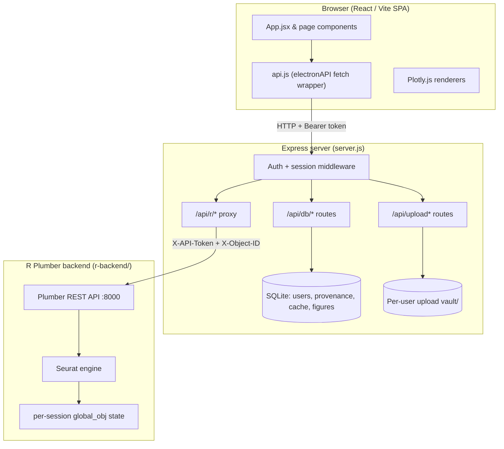

# System Architecture

## Overview
This application is a **web-based** bioinformatics workbench for scRNA-seq analysis.
It pairs the performance of native R scientific libraries (Seurat) with the
responsive UX of a modern single-page web app. It is moving toward a
collaborative multiomics production system; the current focus is production
hardening rather than new scientific features.

> **Historical note.** Earlier iterations were packaged as an Electron desktop
> app whose `main.js` orchestrated a browser window, native file dialogs, and an
> in-process SQLite database over IPC. That entry path has been **removed**.
> There is no `main.js` and no Electron main process at runtime. The active
> entrypoint is the Express server (`server.js`, `npm start`). The browser-side
> API client object is still named `electronAPI` (in `src/api.js`) for
> historical compatibility, but it is a thin `fetch` wrapper to the Express API —
> not an Electron bridge. (`electron` still appears in `devDependencies`; it is
> legacy and slated for removal.)

## Current Architecture

### Components
- **React/Vite frontend (`src/`)** — SPA built with Vite, React 19, TailwindCSS.
  Routing is conditional rendering in `App.jsx` by `activeTab`. Visualization via
  `react-plotly.js`. All server communication goes through `src/api.js`.
- **Express server (`server.js`)** — the single backend process and the app's
  entrypoint. Serves the built frontend from `dist/`, exposes the auth + database
  + upload APIs, and proxies analysis calls to the R backend. Spawns the local R
  Plumber process on startup (dev/local mode).
- **SQLite (`backend/database.js`)** — `better-sqlite3`, opened by the Express
  process (not Electron). Tables: `users`, `provenance`, `results_cache`,
  `figure_collection`.
- **R Plumber/Seurat backend (`r-backend/`)** — stateful R process exposing a
  REST API on `127.0.0.1:8000`, holding the live Seurat object in memory.

### Request flows
- **Browser → Express API → R proxy.** The frontend calls
  `electronAPI.apiRequest('/<endpoint>')`, which `POST`/`GET`s
  `<API_BASE_URL>/api/r/<endpoint>` with the user's Bearer token. Express
  authenticates the request, validates any vault file paths, injects the Plumber
  `X-API-Token` and a per-user `X-Object-ID` state key, then proxies to Plumber.
- **Browser upload.** Files are uploaded to `POST /api/upload` (or
  `/api/upload-directory`) as multipart form data. Express moves each file into
  the authenticated user's vault and returns a relative vault path the frontend
  later passes to R (e.g. `/load-rds`).
- **Frontend API base URL.** `src/api.js` reads `import.meta.env.VITE_API_BASE_URL`.
  When unset it defaults to **same-origin relative requests** (correct for a
  single-origin deployment where Express serves both the SPA and the API). See
  `.env.example`.

## Data & Security Model
- **Authentication.** Email/password signup and login (`/api/auth/*`). Passwords
  are hashed with PBKDF2-SHA512 (600k iterations). Sessions are stateless HMAC
  (SHA-256) signed tokens carrying `sub`/`email`/`exp`, verified per request and
  re-checked against the users table. `SESSION_SECRET` is **required** in
  production (the server refuses to start without it).
- **Authorization / per-user DB scoping.** Every user-owned DB helper takes a
  `userEmail` and scopes its SQL with `AND user_email = ?`. Routes pass
  `req.user.email` from the verified session. Cross-user reads/deletes/overwrites
  of provenance, cache, and figures are rejected at the SQL layer. This is
  covered by `backend/security.test.js` (direct DB layer) **and**
  `backend/http-auth.test.js` (full Express routes, proving the routes actually
  forward `req.user.email`).
- **Per-user upload vault isolation.** Each user has a vault directory keyed by a
  sanitized email segment (`vault/<segment>/`). Upload destinations and any R
  file path are resolved with `resolveVaultPath`, which rejects absolute paths,
  `..` traversal, and any path that escapes the authenticated user's vault. The R
  backend independently re-validates paths against its vault. Covered by
  `backend/server-security.test.js`.
- **Known limitation.** There is **no project/org membership model yet**.
  Authorization is strictly per-individual-user; there is no sharing, no roles,
  and no team-scoped data. Collaboration UI (e.g. the Collaborators page) is an
  explicit mockup, not backed by a membership model.

## Reproducibility / Provenance Model
- **Provenance.** Each R endpoint wraps its result in a provenance envelope
  (`make_provenance` in `r-backend/plumber.R`): id, timestamp, language/version,
  packages, script text, parameters, operation, and `parentIds`. The frontend
  saves the envelope via `POST /api/db/provenance`; the server stamps it with the
  owning `userEmail`. Records form a DAG walked by `getProvenanceChain`.
- **Cache keys.** `makeCacheKey(operation, params, dataVersion, parentIds, userEmail)`
  hashes those inputs (incl. the normalized user email) with SHA-256 and truncates
  to 16 hex chars — so cache keys are intrinsically per-user. Cached results are
  also row-scoped by `user_email`, and a result can only be cached against
  provenance the same user owns.
- **Figures.** Figure metadata is stored in `figure_collection`, scoped by
  `user_email`. A figure id owned by one user cannot be overwritten or deleted by
  another.
- **Known gaps.** Cache invalidation is currently key-based only; there is no
  user-scoped cascade invalidation helper (the previous unscoped
  `deleteProvenanceAfter` / `deleteDownstreamProvenance` helpers were removed
  because they could delete across users — see `backend/database.js`).

## R Execution Model
- **Proxying.** `app.use('/api/r', ...)` authenticates, parses JSON, validates
  vault paths, and proxies to `http://127.0.0.1:8000` via
  `http-proxy-middleware`, stripping the `/api/r` prefix. It injects the Plumber
  `X-API-Token` (a per-process random secret) and an `X-Object-ID` state key.
- **How R state is keyed today.** The R process holds a single live `global_obj`
  (plus `raw_obj`) and saves/restores it per `X-Object-ID` into an
  `active_sessions` environment (filter `session_loader` in `plumber.R`).
  The Express proxy derives that key with `deriveRStateKey(req.user, X-Object-ID)`:
  - The **prefix is always `user-${user.id}`**, taken from the verified session.
    It is never client-controlled, so one user can never address another user's R
    state.
  - If the client supplies an object/dataset id (the frontend already sends the
    active dataset id as `X-Object-ID`), it is sanitized and appended as
    `:obj-<id>`, so two concurrent objects for the *same* user no longer collide
    on one shared `global_obj`. With no object id the key is exactly `user-${id}`,
    preserving prior behavior.
  - Covered by the `deriveRStateKey` tests in `backend/server-security.test.js`.

### R state — remaining design note (production blocker)
`deriveRStateKey` removes the *same-user collision* risk for requests that carry
a distinct object id, and it keeps cross-user isolation intact. It is **not** a
complete fix:
- The object id is a sub-partition of the user's own namespace, not an
  authorization boundary. It is safe precisely because the user prefix is
  server-controlled; the object id itself is **not** verified against an
  ownership record because no such record exists yet.
- R state still lives in a single in-process environment in one R process. There
  is no durable per-object workspace, no job model, and no concurrency control —
  long-running steps still block and state is lost on R restart.

**Prerequisites for the real fix:**
1. An `analysis_objects` table (id, owner `user_email`, dataset lineage) so the
   server can *verify* a requested object id belongs to the caller.
2. A `jobs` model + job queue so each long R computation is an addressable,
   resumable unit keyed by `job_id` (and so requests don't block).
3. R state persisted/loaded per `(user, object|job)` from durable storage rather
   than a single mutable `global_obj`, ideally in per-object R workers/containers.

## Target Production Architecture
- React/Vite frontend (unchanged shape).
- Express API as the auth + orchestration tier.
- A relational database (migrate SQLite → Postgres) with **project/org-scoped
  authorization** (membership + roles), not just per-user rows.
- Object storage (e.g. S3-compatible) for uploads and large R artifacts instead
  of the local `vault/` directory.
- A **job queue** for long-running R computations.
- **R worker/container pool**, with state keyed by analysis object / job id.
- **Audit logs** for data access and mutations.
- **Secure sessions**: migrate browser auth from `localStorage` Bearer tokens to
  httpOnly, secure, SameSite cookies.

## Remaining Blockers
- **HTTP-level auth tests** — done (`backend/http-auth.test.js`).
- **R state keyed by object/job** — *partially* done. Same-user object
  separation and cross-user isolation are in place via `deriveRStateKey`; durable
  per-object/job workspaces + ownership verification remain (see prerequisites
  above).
- **Job queue** for long R tasks — not implemented; long steps block the single R
  process.
- **Secure session/cookie migration** — tokens are still stored in `localStorage`
  on the client; migrate to httpOnly secure cookies.
- **Project/org membership model** — not implemented; authorization is per-user
  only.
- **Deployment target** — not defined (no container/orchestration manifest for
  the full stack beyond the R `Dockerfile`).
- **Object storage** — uploads/artifacts are on local disk (`vault/`).
- **CI / lint / typecheck** — `npm run lint` and `npm run check` exist; no CI
  pipeline wires them up yet, and the project is JS (no typecheck step).

## Known Limitations & Technical Debt
- **Monolithic `App.jsx`** handles routing, session management, and workspace
  state.
- **Pipeline boilerplate** — page components duplicate `running`/`error`/`result`
  handling; partially abstracted into `usePipelineStep`.
- **Lint debt** — `eslint .` passes with 0 errors but ~100 warnings (mostly
  `no-unused-vars` and `react-hooks/*`), including a real hooks-after-return issue
  in `src/pages/QualityControl.jsx` tracked for a follow-up.
