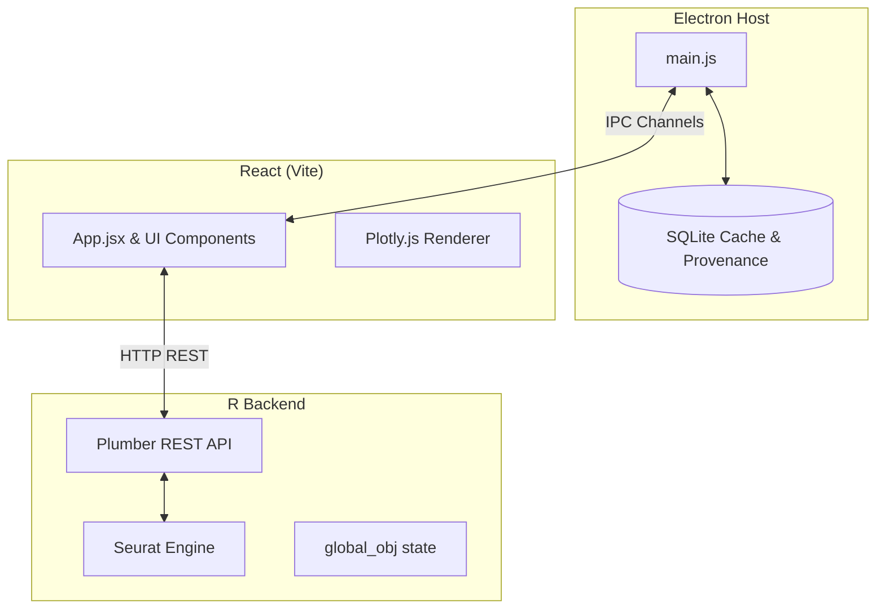

# System Architecture

## Overview
This application is a desktop bioinformatics workbench for scRNA-seq analysis. It is built on a hybrid stack designed to provide the performance of native R scientific libraries with the responsive UX of a modern web application.

## Stack Diagram

## Core Components

### 1. Electron Main Process (`main.js`)
Acts as the orchestrator. Its responsibilities include:
- Bootstrapping the React frontend window.
- Spawning the R process (`Rscript.exe`) as a child process and waiting for it to become healthy.
- Managing native OS dialogs (file picking, saving).
- Managing the persistent SQLite database (`src/database.js`) via IPC handlers.
- Ensuring the R process is cleanly killed when the application closes.

### 2. React Frontend (`src/`)
Built with Vite, React, and TailwindCSS.
- **Routing:** Handled via conditional rendering in `App.jsx` based on `activeTab`.
- **Interactivity:** Uses `react-plotly.js` for heavy data visualization (UMAP, PCA, Violin plots).
- **State:** Uses a mix of React state for UI transients and `localStorage` for semi-persistent configuration (via `useTabParams`).

### 3. R Plumber API (`r-backend/`)
Provides a stateless REST interface over a stateful R environment.
- Listens on `127.0.0.1:8000`.
- Retains the loaded dataset in memory as `global_obj` to avoid reloading gigabytes of data between pipeline steps.
- Uses standard R bioinformatics libraries (`Seurat`, `DropletUtils`).
- Uses `auto_unbox = TRUE` to ensure JSON payloads play nicely with JavaScript arrays.

## Data Flow & IPC

Because the R engine is heavy, the app utilizes a caching architecture to avoid re-running identical mathematical operations:

1. **User Action:** User clicks "Run PCA".
2. **Frontend Request:** React creates a parameter payload and queries the database via IPC to see if this exact operation (with these parameters and this input data version) has run before.
3. **Cache Hit:** If found, the database returns the cached JSON result, React skips the REST call, and updates the UI instantly.
4. **Cache Miss:** React fires a REST call to `http://127.0.0.1:8000/pca`.
5. **Computation:** R runs `RunPCA` on `global_obj`.
6. **Result Handling:** R returns the result (e.g., standard deviations, plot traces). React saves this result to the SQLite cache via IPC, then updates the UI.

## Known Limitations & Technical Debt
- **Monolithic App.jsx:** `App.jsx` currently handles routing, session management, and workspace state.
- **Pipeline Boilerplate:** Pipeline steps (e.g., `PCA.jsx`, `UMAPView.jsx`) duplicate logic for managing `running`/`error`/`result` states and session hydration. This should eventually be abstracted into a `usePipelineStep` hook.
