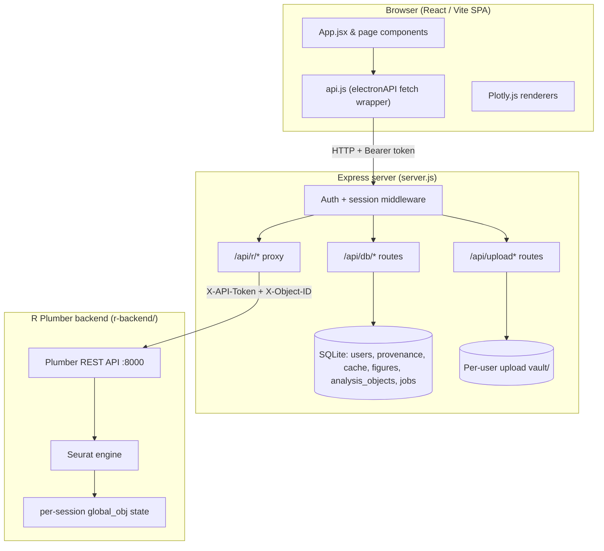

# System Architecture

## Overview
This application is a **web-based** bioinformatics workbench for scRNA-seq analysis.
It pairs the performance of native R scientific libraries (Seurat) with the
responsive UX of a modern single-page web app. It is moving toward a
collaborative multiomics production system; the current focus is production
hardening rather than new scientific features.

> **Historical note.** Earlier iterations were packaged as an Electron desktop
> app whose `main.js` orchestrated a browser window, native file dialogs, and an
> in-process SQLite database over IPC. That entry path has been **removed**.
> There is no `main.js` and no Electron main process at runtime. The active
> entrypoint is the Express server (`server.js`, `npm start`). The browser-side
> API client object is still named `electronAPI` (in `src/api.js`) for
> historical compatibility, but it is a thin `fetch` wrapper to the Express API —
> not an Electron bridge. (`electron` still appears in `devDependencies`; it is
> legacy and slated for removal.)

## Current Architecture

### Components
- **React/Vite frontend (`src/`)** — SPA built with Vite, React 19, TailwindCSS.
  Routing is conditional rendering in `App.jsx` by `activeTab`. Visualization via
  `react-plotly.js`. All server communication goes through `src/api.js`.
- **Express server (`server.js`)** — the single backend process and the app's
  entrypoint. Serves the built frontend from `dist/`, exposes the auth + database
  + upload APIs, and proxies analysis calls to the R backend. Spawns the local R
  Plumber process on startup (dev/local mode).
- **SQLite (`backend/database.js`)** — `better-sqlite3`, opened by the Express
  process (not Electron). Tables: `users`, `provenance`, `results_cache`,
  `figure_collection`, `analysis_objects`, and `jobs`.
- **R Plumber/Seurat backend (`r-backend/`)** — stateful R process exposing a
  REST API on `127.0.0.1:8000`, holding the live Seurat object in memory.

### Request flows
- **Browser → Express API → R proxy.** The frontend calls
  `electronAPI.apiRequest('/<endpoint>')`, which `POST`/`GET`s
  `<API_BASE_URL>/api/r/<endpoint>` with the user's Bearer token. Express
  authenticates the request, validates any vault file paths, injects the Plumber
  `X-API-Token` and a per-user `X-Object-ID` state key, then proxies to Plumber.
- **Browser upload.** Files are uploaded to `POST /api/upload` (or
  `/api/upload-directory`) as multipart form data. Express moves each file into
  the authenticated user's vault and returns a relative vault path the frontend
  later passes to R (e.g. `/load-rds`).
- **Frontend API base URL.** `src/api.js` reads `import.meta.env.VITE_API_BASE_URL`.
  When unset it defaults to **same-origin relative requests** (correct for a
  single-origin deployment where Express serves both the SPA and the API). See
  `.env.example`.

## Data & Security Model
- **Authentication.** Email/password signup and login (`/api/auth/*`). Passwords
  are hashed with PBKDF2-SHA512 (600k iterations). Sessions are stateless HMAC
  (SHA-256) signed tokens carrying `sub`/`email`/`exp`, verified per request and
  re-checked against the users table. `SESSION_SECRET` is **required** in
  production (the server refuses to start without it).
- **Authorization / per-user DB scoping.** Every user-owned DB helper takes a
  `userEmail` and scopes its SQL with `AND user_email = ?`. Routes pass
  `req.user.email` from the verified session. Cross-user reads/deletes/overwrites
  of provenance, cache, and figures are rejected at the SQL layer. This is
  covered by `backend/security.test.js` (direct DB layer) **and**
  `backend/http-auth.test.js` (full Express routes, proving the routes actually
  forward `req.user.email`).
- **Per-user upload vault isolation.** Each user has a vault directory keyed by a
  sanitized email segment (`vault/<segment>/`). Upload destinations and any R
  file path are resolved with `resolveVaultPath`, which rejects absolute paths,
  `..` traversal, and any path that escapes the authenticated user's vault. The R
  backend independently re-validates paths against its vault. Covered by
  `backend/server-security.test.js`.
- **Known limitation.** There is **no project/org membership model yet**.
  Authorization is strictly per-individual-user; there is no sharing, no roles,
  and no team-scoped data. Collaboration UI (e.g. the Collaborators page) is an
  explicit mockup, not backed by a membership model.

## Reproducibility / Provenance Model
- **Provenance.** Each R endpoint wraps its result in a provenance envelope
  (`make_provenance` in `r-backend/plumber.R`): id, timestamp, language/version,
  packages, script text, parameters, operation, and `parentIds`. The frontend
  saves the envelope via `POST /api/db/provenance`; the server stamps it with the
  owning `userEmail`. Records form a DAG walked by `getProvenanceChain`.
- **Cache keys.** `makeCacheKey(operation, params, dataVersion, parentIds, userEmail)`
  hashes those inputs (incl. the normalized user email) with SHA-256 and truncates
  to 16 hex chars — so cache keys are intrinsically per-user. Cached results are
  also row-scoped by `user_email`, and a result can only be cached against
  provenance the same user owns.
- **Figures.** Figure metadata is stored in `figure_collection`, scoped by
  `user_email`. A figure id owned by one user cannot be overwritten or deleted by
  another.
- **Known gaps.** Cache invalidation is currently key-based only; there is no
  user-scoped cascade invalidation helper (the previous unscoped
  `deleteProvenanceAfter` / `deleteDownstreamProvenance` helpers were removed
  because they could delete across users — see `backend/database.js`).

## R Execution Model
- **Proxying.** `app.use('/api/r', ...)` authenticates, parses JSON, validates
  vault paths, verifies analysis-object ownership, and proxies to
  `http://127.0.0.1:8000` via `http-proxy-middleware`, stripping the `/api/r`
  prefix. It injects the Plumber `X-API-Token` (a per-process random secret) and
  a server-derived `X-Object-ID` state key.
- **R is not user-facing.** The R Plumber backend performs no user
  authentication; it trusts the `X-API-Token` and server-derived `X-Object-ID`
  injected by Express. It must only be reachable from the Express tier (bind to
  `127.0.0.1` / a private network) and must **not** trust any client-supplied
  user/path/export header. Example: `/export-figure` derives its export
  subdirectory only from the server-injected `X-Object-ID`, never from the
  request body, and appends a random suffix so concurrent same-second exports by
  different users cannot collide or overwrite each other.
- **Node-side path-field validation + drift guard.** `validateRProxyPaths` only
  validates a fixed allowlist of request fields
  (`R_PROXY_VALIDATED_PATH_FIELDS` in `server.js`: `path`, `csv_path`, `paths`)
  before proxying. R independently re-validates with `validate_path()`, but to
  keep the two in sync `backend/r-path-drift.test.js` statically scans every
  `validate_path()` call site in `plumber.R` and fails if a new path-like
  request field isn't also covered by the Node allowlist. It is a pragmatic
  scanner (not a full R parser) and fails loudly on any argument shape it can't
  resolve, prompting a human to extend it.
  - **Proposal (not yet implemented): per-user vault root in R.** Today R's
    `validate_path()` constrains paths to a single shared `vault/` directory,
    while Express separately resolves each path to the *authenticated user's*
    `vault/<segment>/`. A low-risk hardening would have Express inject a trusted
    `X-Vault-Root` header (derived from the session, like `X-Object-ID`) and
    have R use it as `validate_path()`'s `safe_dir`, so per-user vault-root
    enforcement also exists in R. This is deferred to keep this cleanup small;
    it must reuse the same server-injected-and-overridden header pattern (never
    trust a client-supplied vault root).
- **How R state is keyed today.** The R process holds a single live `global_obj`
  (plus `raw_obj`) and saves/restores it per `X-Object-ID` into an
  `active_sessions` environment (filter `session_loader` in `plumber.R`).
  The Express proxy derives that key with `deriveRStateKey(req.user, objectId)`:
  - The **prefix is always `user-${user.id}`**, taken from the verified session.
    It is never client-controlled, so one user can never address another user's R
    state.
  - If the client supplies an `X-Object-ID`, it is **verified against the
    `analysis_objects` table** by `verifyRObjectOwnership` *before* the request
    reaches R: it must be a real object id owned by the authenticated user.
    Malformed ids are rejected with 400; unknown or not-owned ids with 404. Only
    the verified canonical id is then appended as `:obj-<id>`, so two concurrent
    objects for the *same* user no longer collide on one shared `global_obj`.
    With no object id the key is exactly `user-${id}`, preserving prior behavior.
  - Covered by `deriveRStateKey` tests in `backend/server-security.test.js`,
    object-ownership tests in `backend/r-proxy-ownership.test.js`, and the live
    `scripts/verify_r_state_proxy.js` smoke test.

### Analysis Object Identity & Lineage (`analysis_objects`)
Object identity is durable and ownership-scoped, so an `X-Object-ID` can no
longer be an arbitrary client string that selects R session state:
- The `analysis_objects` table (`backend/database.js`) records each object with a
  server-generated `id` (`ao_<random>`), its integer `owner_user_id`, lineage
  links (`parent_object_id`, `lineage_root_id`), and optional `dataset_id`,
  `created_by_provenance_id`, `object_type`, and JSON `metadata`. It is indexed by
  owner, dataset, parent, lineage root, and provenance.
- Object ids are **server-issued only**. `POST /api/analysis-objects` rejects any
  client-supplied `id` or owner field (`userId`, `owner_user_id`, …); ownership
  always comes from `req.user`.
- Linked references are ownership-checked at creation: a `parentObjectId` or
  `createdByProvenanceId` not owned by the caller is rejected (404). Lineage root
  is inherited from the parent, or set to the object's own id for a root object.
- Routes (`POST` / `GET` / `GET /:id` under `/api/analysis-objects`) are
  authenticated and owner-scoped; not-owned/unknown ids return 404. A test-only
  `GET /api/r/__test/state-key` diagnostic exposes the derived key (gated by
  `ENABLE_R_TEST_DIAGNOSTICS`, 404 in production / when disabled).

### Jobs / Task Execution (`jobs`)
Long-running analysis is no longer modeled as *only* a browser request/response.
The `jobs` table (`backend/database.js`) gives each unit of work a durable,
ownership-scoped record:
- Each row has a server-generated `id` (`job_<random>`), an integer
  `owner_user_id`, an optional target `analysis_object_id` and
  `result_analysis_object_id`, a `job_type`, an explicit `status`, the
  `parameters_json` it was created with, an append-only `logs_json`, an optional
  structured `error_json`, and lifecycle timestamps (`created/updated/started/
  completed/canceled_at`). Indexed by owner, analysis object, result object,
  type, status, and creation time.
- **Identity & ownership are server-owned.** `POST /api/jobs` rejects any
  client-supplied `id`, owner field (`userId`, `owner_user_id`, …), or `status`;
  ownership always comes from `req.user`. A supplied `analysisObjectId` must be a
  real object owned by the caller (else 404, no enumeration).
- **Status is a server-managed state machine.** Statuses are `created`,
  `queued`, `running`, `waiting_for_user`, `completed`, `failed`, `canceled`.
  Jobs are created `queued`. Transitions are an explicit allow-list
  (`validateJobTransition`): `created→queued`, `queued→running`,
  `running→{completed,failed,waiting_for_user}`, `waiting_for_user→{queued,
  running}`, and any non-terminal status `→canceled`; `completed`/`failed`/
  `canceled` are terminal. Clients cannot set an arbitrary status — they may only
  create and cancel; all other transitions go through `updateJobStatusForUser`
  (the path a future worker will use). A linked `resultAnalysisObjectId` is
  ownership-verified the same way.
- Routes (`POST /api/jobs`, `GET /api/jobs`, `GET /api/jobs/:id`,
  `GET /api/jobs/:id/logs`, `POST /api/jobs/:id/cancel`) are authenticated and
  owner-scoped; unknown/not-owned ids return 404, and canceling an already-
  terminal job returns 409. Covered by `backend/jobs.test.js` (HTTP ownership +
  the status-machine/helper layer).
- **Scope of this branch.** This is the *durable record + API + ownership
  boundary* only. There is **no worker or queue draining jobs yet**: nothing
  advances a job past `queued`, and existing R proxy execution is unchanged and
  still synchronous. Jobs are not yet wired into the R proxy (no `X-Job-ID`).

### R state — remaining design note (production blocker)
`deriveRStateKey` keeps cross-user isolation intact, and `verifyRObjectOwnership`
now confirms any client object id is a real `analysis_objects` row owned by the
caller before it can influence R state. That closes the *client-controlled object
id* gap, but the R execution model is still **not** production-grade:
- R state still lives in a single in-process environment in one R process. The
  `jobs` table exists as a durable record, but no worker drains it and R work is
  still synchronous with no concurrency control — long-running steps still block
  and live R state is lost on R restart.

**Prerequisites for the real fix:**
1. ~~An `analysis_objects` table so the server can *verify* a requested object id
   belongs to the caller.~~ **Done** (`analysis_objects` + `verifyRObjectOwnership`).
2. A `jobs` model + job queue so each long R computation is an addressable,
   resumable unit keyed by `job_id` (and so requests don't block). **Partially
   done** (this branch): the durable, owner-scoped `jobs` model + API exist; a
   queue/worker that actually executes jobs and wires `job_id` into R does not.
3. R state persisted/loaded per `(user, object|job)` from durable storage rather
   than a single mutable `global_obj`, ideally in per-object R workers/containers.

## Target Production Architecture
- React/Vite frontend (unchanged shape).
- Express API as the auth + orchestration tier.
- A relational database (migrate SQLite → Postgres) with **project/org-scoped
  authorization** (membership + roles), not just per-user rows.
- Object storage (e.g. S3-compatible) for uploads and large R artifacts instead
  of the local `vault/` directory.
- A **job queue** for long-running R computations.
- **R worker/container pool**, with state keyed by analysis object / job id.
- **Audit logs** for data access and mutations.
- **Secure sessions**: migrate browser auth from `localStorage` Bearer tokens to
  httpOnly, secure, SameSite cookies.

## Remaining Blockers
- **HTTP-level auth tests** — done (`backend/http-auth.test.js`).
- **Analysis object identity + R object-ownership verification** — done
  (`analysis_objects` table, `verifyRObjectOwnership`).
- **R state keyed by object/job** — *partially* done. Same-user object
  separation, cross-user isolation, and DB-backed object-ownership verification
  are in place; durable per-object/job workspaces remain (see prerequisites
  above).
- **Jobs model** — done as a *durable record + owner-scoped API* (`jobs` table,
  `/api/jobs`, server-managed status machine). It is the foundation for
  backgrounding R work but is **not** an executor.
- **Job queue / worker** for long R tasks — not implemented; nothing drains the
  `jobs` queue, jobs are not wired into the R proxy, and long steps still block
  the single R process.
- **Secure session/cookie migration** — tokens are still stored in `localStorage`
  on the client; migrate to httpOnly secure cookies.
- **Project/org membership model** — not implemented; authorization is per-user
  only. `dataset_id` on analysis objects is an opaque nullable tag until a
  durable datasets/projects model lands.
- **Deployment target** — not defined (no container/orchestration manifest for
  the full stack beyond the R `Dockerfile`).
- **Object storage** — uploads/artifacts are on local disk (`vault/`).
- **CI / lint / typecheck** — `npm run lint` and `npm run check` exist; no CI
  pipeline wires them up yet, and the project is JS (no typecheck step).

## Known Limitations & Technical Debt
- **Monolithic `App.jsx`** handles routing, session management, and workspace
  state.
- **Pipeline boilerplate** — page components duplicate `running`/`error`/`result`
  handling; partially abstracted into `usePipelineStep`.
- **Lint debt** — `eslint .` passes with 0 errors but ~100 warnings (mostly
  `no-unused-vars` and `react-hooks/*`), including a real hooks-after-return issue
  in `src/pages/QualityControl.jsx` tracked for a follow-up.
- **No queue/worker draining the `jobs` model** (the durable job record exists,
  but execution is still synchronous and not job-backed), **no project/org
  collaboration authorization**, **no full object-storage or durable R-worker
  execution model**, and **no complete reproducibility artifact model** —
  analysis-object ownership and the durable jobs model are security/foundation
  work, not a claim of production-grade R execution.
