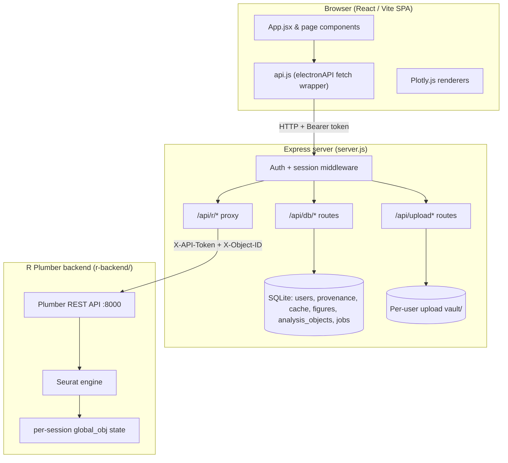

# System Architecture

## Overview
This application is a **web-based** bioinformatics workbench for scRNA-seq analysis.
It pairs the performance of native R scientific libraries (Seurat) with the
responsive UX of a modern single-page web app. It is moving toward a
collaborative multiomics production system; the current focus is production
hardening rather than new scientific features.

> **Historical note.** Earlier iterations were packaged as an Electron desktop
> app whose `main.js` orchestrated a browser window, native file dialogs, and an
> in-process SQLite database over IPC. That entry path has been **removed**.
> There is no `main.js` and no Electron main process at runtime. The active
> entrypoint is the Express server (`server.js`, `npm start`). The browser-side
> API client object is still named `electronAPI` (in `src/api.js`) for
> historical compatibility, but it is a thin `fetch` wrapper to the Express API —
> not an Electron bridge. (`electron` still appears in `devDependencies`; it is
> legacy and slated for removal.)

## Current Architecture

### Components
- **React/Vite frontend (`src/`)** — SPA built with Vite, React 19, TailwindCSS.
  Routing is conditional rendering in `App.jsx` by `activeTab`. Visualization via
  `react-plotly.js`. All server communication goes through `src/api.js`.
- **Express server (`server.js`)** — the single backend process and the app's
  entrypoint. Serves the built frontend from `dist/`, exposes the auth + database
  + upload APIs, and proxies analysis calls to the R backend. Spawns the local R
  Plumber process on startup (dev/local mode).
- **SQLite (`backend/database.js`)** — `better-sqlite3`, opened by the Express
  process (not Electron). Tables: `users`, `provenance`, `results_cache`,
  `figure_collection`, `analysis_objects`, `jobs`, and the org/project
  authorization tables `organizations`, `organization_members`, `projects`,
  `project_members`.
- **R Plumber/Seurat backend (`r-backend/`)** — stateful R process exposing a
  REST API on `127.0.0.1:8000`, holding the live Seurat object in memory.

### Request flows
- **Browser → Express API → R proxy.** The frontend calls
  `electronAPI.apiRequest('/<endpoint>')`, which `POST`/`GET`s
  `<API_BASE_URL>/api/r/<endpoint>` with the user's Bearer token. Express
  authenticates the request, validates any vault file paths, injects the Plumber
  `X-API-Token` and a per-user `X-Object-ID` state key, then proxies to Plumber.
- **Browser upload.** Files are uploaded to `POST /api/upload` (or
  `/api/upload-directory`) as multipart form data. Express moves each file into
  the authenticated user's vault and returns a relative vault path the frontend
  later passes to R (e.g. `/load-rds`).
- **Frontend API base URL.** `src/api.js` reads `import.meta.env.VITE_API_BASE_URL`.
  When unset it defaults to **same-origin relative requests** (correct for a
  single-origin deployment where Express serves both the SPA and the API). See
  `.env.example`.

## Data & Security Model
- **Authentication.** Email/password signup and login (`/api/auth/*`). Passwords
  are hashed with PBKDF2-SHA512 (600k iterations). Sessions are stateless HMAC
  (SHA-256) signed tokens carrying `sub`/`email`/`exp`, verified per request and
  re-checked against the users table. `SESSION_SECRET` is **required** in
  production (the server refuses to start without it).
- **Authorization / per-user DB scoping.** Every user-owned DB helper takes a
  `userEmail` and scopes its SQL with `AND user_email = ?`. Routes pass
  `req.user.email` from the verified session. Cross-user reads/deletes/overwrites
  of provenance, cache, and figures are rejected at the SQL layer. This is
  covered by `backend/security.test.js` (direct DB layer) **and**
  `backend/http-auth.test.js` (full Express routes, proving the routes actually
  forward `req.user.email`).
- **Per-user upload vault isolation.** Each user has a vault directory keyed by a
  sanitized email segment (`vault/<segment>/`). Upload destinations and any R
  file path are resolved with `resolveVaultPath`, which rejects absolute paths,
  `..` traversal, and any path that escapes the authenticated user's vault. The R
  backend independently re-validates paths against its vault. Covered by
  `backend/server-security.test.js`.
- **Organization / project authorization foundation.** There is now a durable
  org/project membership + authorization layer (`organizations`,
  `organization_members`, `projects`, `project_members`) with four roles
  (`owner`, `admin`, `analyst`, `viewer`) and the `/api/organizations` +
  `/api/projects` route family. See *Organization & Project Authorization*
  below. Building on this foundation, **datasets** are project-scoped (see
  *Datasets*) and **analysis objects and jobs now carry a project association for
  project metadata/history** (see *Project-scoped analysis objects & jobs*).
  **Important:** `provenance`, `cache`, and `figures` remain strictly
  **user-scoped**, and — most importantly — **R execution/state keying is
  unchanged and stays user/object-keyed**. Project membership grants visibility of
  metadata/history by role; it does **not** grant access to another user's live R
  session, and there is no shared mutable project R state. The collaboration UI
  remains a mockup until execution is migrated onto these primitives in a later
  branch.

## Reproducibility / Provenance Model
- **Provenance.** Each R endpoint wraps its result in a provenance envelope
  (`make_provenance` in `r-backend/plumber.R`): id, timestamp, language/version,
  packages, script text, parameters, operation, and `parentIds`. The frontend
  saves the envelope via `POST /api/db/provenance`; the server stamps it with the
  owning `userEmail`. Records form a DAG walked by `getProvenanceChain`.
- **Cache keys.** `makeCacheKey(operation, params, dataVersion, parentIds, userEmail)`
  hashes those inputs (incl. the normalized user email) with SHA-256 and truncates
  to 16 hex chars — so cache keys are intrinsically per-user. Cached results are
  also row-scoped by `user_email`, and a result can only be cached against
  provenance the same user owns.
- **Figures.** Figure metadata is stored in `figure_collection`, scoped by
  `user_email`. A figure id owned by one user cannot be overwritten or deleted by
  another.
- **Known gaps.** Cache invalidation is currently key-based only; there is no
  user-scoped cascade invalidation helper (the previous unscoped
  `deleteProvenanceAfter` / `deleteDownstreamProvenance` helpers were removed
  because they could delete across users — see `backend/database.js`).

## R Execution Model
- **Proxying.** `app.use('/api/r', ...)` authenticates, parses JSON, validates
  vault paths, verifies analysis-object ownership, and proxies to
  `http://127.0.0.1:8000` via `http-proxy-middleware`, stripping the `/api/r`
  prefix. It injects the Plumber `X-API-Token` (a per-process random secret) and
  a server-derived `X-Object-ID` state key.
- **R is not user-facing.** The R Plumber backend performs no user
  authentication; it trusts the `X-API-Token` and server-derived `X-Object-ID`
  injected by Express. It must only be reachable from the Express tier (bind to
  `127.0.0.1` / a private network) and must **not** trust any client-supplied
  user/path/export header. Example: `/export-figure` derives its export
  subdirectory only from the server-injected `X-Object-ID`, never from the
  request body, and appends a random suffix so concurrent same-second exports by
  different users cannot collide or overwrite each other.
- **Node-side path-field validation + drift guard.** `validateRProxyPaths` only
  validates a fixed allowlist of request fields
  (`R_PROXY_VALIDATED_PATH_FIELDS` in `server.js`: `path`, `csv_path`, `paths`)
  before proxying. R independently re-validates with `validate_path()`, but to
  keep the two in sync `backend/r-path-drift.test.js` statically scans every
  `validate_path()` call site in `plumber.R` and fails if a new path-like
  request field isn't also covered by the Node allowlist. It is a pragmatic
  scanner (not a full R parser) and fails loudly on any argument shape it can't
  resolve, prompting a human to extend it.
  - **Proposal (not yet implemented): per-user vault root in R.** Today R's
    `validate_path()` constrains paths to a single shared `vault/` directory,
    while Express separately resolves each path to the *authenticated user's*
    `vault/<segment>/`. A low-risk hardening would have Express inject a trusted
    `X-Vault-Root` header (derived from the session, like `X-Object-ID`) and
    have R use it as `validate_path()`'s `safe_dir`, so per-user vault-root
    enforcement also exists in R. This is deferred to keep this cleanup small;
    it must reuse the same server-injected-and-overridden header pattern (never
    trust a client-supplied vault root).
- **How R state is keyed today.** The R process holds a single live `global_obj`
  (plus `raw_obj`) and saves/restores it per `X-Object-ID` into an
  `active_sessions` environment (filter `session_loader` in `plumber.R`).
  The Express proxy derives that key with `deriveRStateKey(req.user, objectId)`:
  - The **prefix is always `user-${user.id}`**, taken from the verified session.
    It is never client-controlled, so one user can never address another user's R
    state.
  - If the client supplies an `X-Object-ID`, it is **verified against the
    `analysis_objects` table** by `verifyRObjectOwnership` *before* the request
    reaches R: it must be a real object id owned by the authenticated user.
    Malformed ids are rejected with 400; unknown or not-owned ids with 404. Only
    the verified canonical id is then appended as `:obj-<id>`, so two concurrent
    objects for the *same* user no longer collide on one shared `global_obj`.
    With no object id the key is exactly `user-${id}`, preserving prior behavior.
  - Covered by `deriveRStateKey` tests in `backend/server-security.test.js`,
    object-ownership tests in `backend/r-proxy-ownership.test.js`, and the live
    `scripts/verify_r_state_proxy.js` smoke test.

### Analysis Object Identity & Lineage (`analysis_objects`)
Object identity is durable and ownership-scoped, so an `X-Object-ID` can no
longer be an arbitrary client string that selects R session state:
- The `analysis_objects` table (`backend/database.js`) records each object with a
  server-generated `id` (`ao_<random>`), its integer `owner_user_id`, lineage
  links (`parent_object_id`, `lineage_root_id`), and optional `dataset_id`,
  `created_by_provenance_id`, `object_type`, and JSON `metadata`. It is indexed by
  owner, dataset, parent, lineage root, and provenance.
- Object ids are **server-issued only**. `POST /api/analysis-objects` rejects any
  client-supplied `id` or owner field (`userId`, `owner_user_id`, …); ownership
  always comes from `req.user`.
- Linked references are ownership-checked at creation: a `parentObjectId` or
  `createdByProvenanceId` not owned by the caller is rejected (404). Lineage root
  is inherited from the parent, or set to the object's own id for a root object.
- An optional `datasetId` is now **verified against the project-scoped `datasets`
  model** (see *Datasets*): malformed → 400, unknown/inaccessible → 404, viewer of
  the dataset's project → 403. It is no longer an opaque tag.
- Objects now also carry a nullable `project_id` for **project metadata/history**
  (see *Project-scoped analysis objects & jobs* below). Legacy rows created
  through the owner-scoped route keep a NULL `project_id`; creator ownership
  (`owner_user_id`) is always retained. **Project association does not change R
  state keying** — `verifyRObjectOwnership` is unchanged and still owner-verified.
- Routes (`POST` / `GET` / `GET /:id` under `/api/analysis-objects`) are
  authenticated and owner-scoped; not-owned/unknown ids return 404. A test-only
  `GET /api/r/__test/state-key` diagnostic exposes the derived key (gated by
  `ENABLE_R_TEST_DIAGNOSTICS`, 404 in production / when disabled).

### Jobs / Task Execution (`jobs`)
Long-running analysis is no longer modeled as *only* a browser request/response.
The `jobs` table (`backend/database.js`) gives each unit of work a durable,
ownership-scoped record:
- Each row has a server-generated `id` (`job_<random>`), an integer
  `owner_user_id`, an optional target `analysis_object_id` and
  `result_analysis_object_id`, a `job_type`, an explicit `status`, the
  `parameters_json` it was created with, an append-only `logs_json`, an optional
  structured `error_json`, and lifecycle timestamps (`created/updated/started/
  completed/canceled_at`). Indexed by owner, analysis object, result object,
  type, status, and creation time.
- **Identity & ownership are server-owned.** `POST /api/jobs` rejects any
  client-supplied `id`, owner field (`userId`, `owner_user_id`, …), or `status`;
  ownership always comes from `req.user`. A supplied `analysisObjectId` must be a
  real object owned by the caller (else 404, no enumeration). An optional
  `datasetId` (column `dataset_id`) is verified the same way as on analysis
  objects — against the project-scoped `datasets` model (malformed → 400,
  unknown/inaccessible → 404, viewer → 403). Jobs now also carry a nullable
  `project_id` for project metadata/history (see *Project-scoped analysis objects
  & jobs* below); creator ownership (`owner_user_id`) is always retained, and the
  job is not made project-shared at the R-execution level.
- **Status is a server-managed state machine.** Statuses are `created`,
  `queued`, `running`, `waiting_for_user`, `completed`, `failed`, `canceled`.
  Jobs are created `queued`. Transitions are an explicit allow-list
  (`validateJobTransition`): `created→queued`, `queued→running`,
  `running→{completed,failed,waiting_for_user}`, `waiting_for_user→{queued,
  running}`, and any non-terminal status `→canceled`; `completed`/`failed`/
  `canceled` are terminal. Clients cannot set an arbitrary status — they may only
  create and cancel; all other transitions go through `updateJobStatusForUser`
  (the path a future worker will use). A linked `resultAnalysisObjectId` is
  ownership-verified the same way.
- Routes (`POST /api/jobs`, `GET /api/jobs`, `GET /api/jobs/:id`,
  `GET /api/jobs/:id/logs`, `POST /api/jobs/:id/cancel`) are authenticated and
  owner-scoped; unknown/not-owned ids return 404, and canceling an already-
  terminal job returns 409. Covered by `backend/jobs.test.js` (HTTP ownership +
  the status-machine/helper layer).
- **Scope of this branch.** This is the *durable record + API + ownership
  boundary* only. There is **no worker or queue draining jobs yet**: nothing
  advances a job past `queued`, and existing R proxy execution is unchanged and
  still synchronous. Jobs are not yet wired into the R proxy (no `X-Job-ID`).

### Organization & Project Authorization (`organizations`, `projects`)
The first durable org/project authorization layer. This branch adds the
*membership + authorization primitives only* — it deliberately does **not**
migrate any existing resource into project ownership.

- **Tables** (`backend/database.js`):
  - `organizations` — server-generated id (`org_<random>`), `name`,
    `owner_user_id`, timestamps.
  - `organization_members` — `(organization_id, user_id)` PK, `role`, timestamps.
  - `projects` — server-generated id (`proj_<random>`), `organization_id`,
    `name`, `description`, `created_by_user_id`, timestamps.
  - `project_members` — `(project_id, user_id)` PK, `role`, timestamps.
- **Roles** (`owner`, `admin`, `analyst`, `viewer`):
  - `owner` — full control over the org/project and its membership, including the
    only role that may **grant the `owner` role** or **demote/remove an existing
    `owner`**.
  - `admin` — manage projects and `admin`/`analyst`/`viewer` members, but an admin
    **cannot grant the `owner` role, and cannot demote or remove an existing
    `owner`** (those operations are owner-only and return **403**). An admin
    therefore cannot escalate itself to owner or evict an owner. The **last owner
    of a project can never be removed or demoted** by anyone (409).
  - `analyst` — read project + (intended) run/upload later; **no resource sharing
    in this branch**, and cannot manage members.
  - `viewer` — read-only project access.
- **Identity is server-owned.** Org/project ids are server-generated; `POST`
  routes reject any client-supplied `id`, owner/creator field (`ownerUserId`,
  `owner_user_id`, `createdByUserId`, `created_by_user_id`, `userId`, `user_id`),
  or `role`. Ownership always comes from `req.user`. The org/project creator is
  seeded as `owner` in the same transaction as the row.
- **Authorization helpers** (`backend/database.js`):
  `verifyOrganizationMember` / `requireOrganizationRole`,
  `verifyProjectMember` / `requireProjectRole`, plus
  `listOrganizationsForUser` / `listProjectsForUser`, membership mutators
  (`addOrganizationMember`, `addProjectMemberByEmail`,
  `updateProjectMemberRole`, `removeProjectMember`), and the `countProjectOwners`
  last-owner guard. The `require*Role` helpers distinguish **404** (not a member —
  never reveal the resource exists) from **403** (a known member lacking the
  required role).
- **Routes** (all authenticated): `POST/GET /api/organizations`,
  `GET /api/organizations/:id`, `POST/GET /api/projects`,
  `GET/PATCH /api/projects/:id`, and the project-member family
  `GET/POST /api/projects/:id/members`,
  `PATCH/DELETE /api/projects/:id/members/:userId`. Creating a project requires
  the caller to be `owner`/`admin` of the parent org. Member management requires
  project `owner`/`admin`; viewing the member list is allowed for any member.
  **Owner-role operations are owner-only:** the route passes the acting caller's
  role into the DB helpers (`addProjectMemberByEmail` / `updateProjectMemberRole`
  / `removeProjectMember`), which reject any non-owner attempt to grant, demote,
  or remove an `owner` with **403** — so this cannot be bypassed even if a future
  route forgets the check (the helpers fail closed on a missing acting role).
- **Member management constraints.** Members are added by **exact email** of an
  existing account — there is no invitation flow, no email sending, and no broad
  user-search endpoint (co-members can see each other, which is not enumeration).
  Only an `owner` may grant the `owner` role or demote/remove an `owner` (403 for
  a non-owner); the **last owner of a project cannot be removed or demoted** (409).
  Duplicate adds (409) and malformed roles (400) are rejected.
- **Project membership is independent of org membership** in this branch: a user
  can be a project member without an org-member row. This is intentional for the
  narrow foundation; a later branch may tighten it.
- **What this branch is NOT.** No resource is project-scoped yet (analysis
  objects, jobs, provenance, cache, figures stay user-scoped); R state keying is
  untouched; there is **no shared R execution state**; and there are **no
  invitations, comments, audit logs, datasets table, public links, or
  project-scoped uploads**. This is not a claim of production-ready
  collaboration. Covered by `backend/organizations.test.js` (HTTP routes +
  DB-helper layer). (The *datasets* layer below — added in a later branch — is
  the first resource to actually become project-scoped.)

### Datasets (project-scoped) (`datasets`)
The first durable, **project-scoped** resource. A dataset is an uploaded or
registered data file that belongs to exactly one project; access is governed by
the caller's `project_members` role, not by per-user ownership. This is also the
branch that closes the long-standing `datasetId` gap: an opaque, unverified tag
on analysis objects/jobs becomes a reference to a real, access-checked dataset.

- **Table** (`backend/database.js`): `datasets` — server-generated `id`
  (`ds_<random>`), `project_id`, `owner_user_id`, `created_by_user_id`,
  `original_filename` (display-only), `internal_storage_key` (server-chosen),
  `storage_uri`, `file_type`, `file_size_bytes`, `sha256`, `upload_status`,
  `validation_status`, `validation_errors` (JSON), `metadata` (JSON), and
  timestamps. Indexed by project, owner, creator, file type, upload/validation
  status, creation time, and sha256.
- **Project-scoped, role-checked access.** Every dataset helper authorizes
  through the project role: `createDatasetForProject` / `updateDatasetForProject`
  require **owner/admin/analyst**; `listDatasetsForProject` /
  `getDatasetForProject` allow **any member (incl. viewer)** to read metadata.
  `verifyDatasetProjectAccess(userId, datasetId, roles)` resolves a dataset by id
  and authorizes the caller against the dataset's *own* project. As elsewhere, a
  dataset in a project the caller cannot access returns **404** (no existence
  leak, including cross-project/cross-user references); a known member lacking the
  role returns **403**; a malformed `ds_...` id returns **400**.
- **Identity & storage are server-owned.** Ids are server-generated. The
  `POST`/`PATCH` routes reject any client-supplied `id`, owner/creator/project
  field (`ownerUserId`, `createdByUserId`, `projectId`, `userId`, …), the storage
  key/uri (`internalStorageKey`, `storageUri`), the computed `sha256`/
  `fileSizeBytes`, and any raw path field (`path`, `filePath`, `storagePath`, …).
  On a multipart upload the **server chooses the storage location** — under the
  controlled vault root, keyed by the (server-generated) project + dataset ids and
  a sanitized, display-only filename — and computes `sha256` + size from the
  stored bytes. The supplied original filename is sanitized for display/metadata
  only and is **never** used as a storage path. `internal_storage_key` is omitted
  from all API responses so the server's storage layout is never disclosed.
- **Constrained enums.** `file_type` ∈ {`tenx_zip`, `tenx_h5`, `seurat_rds`,
  `h5seurat`, `h5ad`, `count_matrix_csv`, `count_matrix_tsv`, `metadata_csv`,
  `metadata_tsv`}; `upload_status` ∈ {`pending`, `uploaded`, `failed`};
  `validation_status` ∈ {`pending`, `valid`, `invalid`, `skipped`}. A value
  outside the allow-list is rejected (400). **Validation here is metadata-level
  only** — no deep biological/format parsing is performed or claimed.
- **Honest upload state.** A registered-but-not-yet-stored dataset is `pending`;
  a storage failure marks it `failed` (never a misleading `uploaded`). A dataset
  can never be `validation_status = valid` unless `upload_status = uploaded`
  (enforced on both create and update), so a pending/failed upload cannot be
  represented as a valid dataset.
- **Routes** (authenticated, under `/api/projects/:projectId/datasets`):
  `POST` (JSON registration *or* multipart upload), `GET` (list, with
  project-scoped `fileType`/`uploadStatus`/`validationStatus` filters that cannot
  widen beyond the project), `GET /:datasetId`, `PATCH /:datasetId` (client-safe
  fields only: statuses, validation errors, metadata, display filename). There
  are intentionally **no dataset download/artifact routes** in this branch —
  serving stored bytes adds extra path/authorization surface and is deferred.
- **`datasetId` verification on existing resources.** `POST /api/analysis-objects`
  and `POST /api/jobs` still accept an **optional** `datasetId`, but a supplied
  value is now verified: malformed → **400**; unknown/inaccessible (including a
  dataset in another user's/project's scope) → **404**; a member who is only a
  `viewer` of the dataset's project → **403** (create/run-like actions require
  owner/admin/analyst). `jobs` gained a `dataset_id` column for this.
- **Scope of the datasets branch.** Datasets were the first project-scoped
  resource. A *later* branch (see *Project-scoped analysis objects & jobs* below)
  then gave analysis objects and jobs their own `project_id` association and
  project-member metadata APIs. In **both** branches **R execution/state remains
  user/object-keyed** — there is no project-shared R state. No dataset download
  routes, no invitations, no comments, no public links. Covered by
  `backend/datasets.test.js` (HTTP routes + DB-helper layer) with
  `backend/analysis-objects.test.js` / `backend/jobs.test.js` covering the
  reference checks.
- **Known limitations (storage / hashing).** These are acceptable under the
  current upload size limit (`MAX_UPLOAD_BYTES`, default 512 MB) but should be
  revisited before very large uploads or production-scale object storage:
  - *In-memory hashing.* multer streams the upload to a temp file on disk, but
    the sha256 is then computed by reading the whole file back into memory in one
    buffer. This should become streaming hashing (hash a read stream) before the
    upload limit is raised significantly.
  - *Storage layout.* Dataset *metadata* is project-scoped, but the uploaded
    *bytes* are currently stored under the existing per-user local vault layout
    (keyed by the uploader). This is invisible today because there are no download
    routes and `internal_storage_key` is never returned, but the project-scoped /
    object-storage layout should be revisited **before** any dataset download or
    artifact-serving route is added — not retrofitted afterward.
  - *Cross-filesystem moves.* The temp-file → vault move uses `rename`, which
    fails (`EXDEV`) if the temp dir and vault are on different filesystems; the
    failure is handled honestly (the dataset is marked `failed`), but a
    copy-then-unlink fallback is a future follow-up for such deployments.

### Project-scoped analysis objects & jobs (`analysis_objects.project_id`, `jobs.project_id`)
Analysis objects and jobs now carry a nullable `project_id` so their **metadata
and history** can be associated with a project and read by project members
according to role. This is deliberately a *metadata/authorization* layer — it
does **not** make R execution or live R state project-shared.

- **Schema.** `analysis_objects` and `jobs` each gained a nullable `project_id`
  (idempotent migration; existing rows keep `NULL` and remain reachable only
  through the owner-scoped routes). Composite indexes were added for the project
  list/filter paths: `analysis_objects(project_id[, dataset_id | parent_object_id
  | lineage_root_id | owner_user_id])` and `jobs(project_id[, status |
  analysis_object_id | result_analysis_object_id | dataset_id])`. **Both
  `project_id` (which project owns this metadata) and `owner_user_id` (which user
  created/is responsible) are kept** — project scope and creator ownership answer
  different questions.
- **Project-scoped, role-checked access** (helpers in `backend/database.js`):
  `createProjectAnalysisObject` / `createProjectJob` require **owner/admin/
  analyst**; `listProject*` / `getProject*` allow **any member (incl. viewer)** to
  read metadata/logs. All authorize through `requireProjectRole`, so an
  inaccessible project/object/job returns **404** (no existence leak), a known
  member lacking the role returns **403**, and a malformed `ao_`/`job_` id returns
  **400**.
- **Identity & scope are server-owned.** `project_id` is taken from the route
  project, never the body. The `POST` routes reject any client-supplied `id`,
  owner/creator field (`ownerUserId`, `createdByUserId`, `userId`, …), `project_id`
  field, server-derived `lineageRootId`, and (for jobs) any `status`. Object/job
  ids and the initial `queued` status are server-generated.
- **References cannot cross the project.** A supplied `datasetId`,
  `parentObjectId`, `analysisObjectId`, or `resultAnalysisObjectId` must resolve
  **within the same project** as the route (else 404). Child lineage root is
  inherited only from an in-project parent, so **lineage can never cross a project
  boundary**.
- **Routes** (authenticated, under `/api/projects/:projectId`):
  `POST/GET /analysis-objects`, `GET /analysis-objects/:objectId`,
  `POST/GET /jobs`, `GET /jobs/:jobId`, `GET /jobs/:jobId/logs`,
  `POST /jobs/:jobId/cancel`. The existing owner-scoped `/api/analysis-objects`
  and `/api/jobs` routes are unchanged and still pass their suites.
- **Cancel policy.** owner/admin may cancel any cancelable job in the project;
  an **analyst may cancel only their own** cancelable jobs (else 403); a **viewer
  may not cancel** (403); an already-terminal job returns **409**. Cancel is the
  only project-scoped *mutation* in this branch and touches no R process.
- **R execution/state is explicitly NOT project-shared.** A project member seeing
  an object's metadata does **not** gain access to another user's live R session.
  R state stays user/object-keyed: `verifyRObjectOwnership` still requires the
  `X-Object-ID` to be an `analysis_objects` row **owned by the caller**, so a
  project co-member supplying another member's object id to `/api/r/*` is rejected
  (404) before the request reaches R. This is asserted directly in
  `backend/project-analysis-resources.test.js`.
- **Scope of this branch.** Project association of analysis-object/job *metadata*
  only. **No shared/mutable project R state, no worker or queue draining jobs, no
  download/object-storage/comment/invitation/audit-log/public-link features, and
  no new scientific features.** This is **not** a claim of production-ready
  collaboration. Covered by `backend/project-analysis-resources.test.js` (HTTP
  routes + the R-ownership-unchanged assertions).

### R state — remaining design note (production blocker)
`deriveRStateKey` keeps cross-user isolation intact, and `verifyRObjectOwnership`
now confirms any client object id is a real `analysis_objects` row owned by the
caller before it can influence R state. That closes the *client-controlled object
id* gap, but the R execution model is still **not** production-grade:
- R state still lives in a single in-process environment in one R process. The
  `jobs` table exists as a durable record, but no worker drains it and R work is
  still synchronous with no concurrency control — long-running steps still block
  and live R state is lost on R restart.

**Prerequisites for the real fix:**
1. ~~An `analysis_objects` table so the server can *verify* a requested object id
   belongs to the caller.~~ **Done** (`analysis_objects` + `verifyRObjectOwnership`).
2. A `jobs` model + job queue so each long R computation is an addressable,
   resumable unit keyed by `job_id` (and so requests don't block). **Partially
   done** (this branch): the durable, owner-scoped `jobs` model + API exist; a
   queue/worker that actually executes jobs and wires `job_id` into R does not.
3. R state persisted/loaded per `(user, object|job)` from durable storage rather
   than a single mutable `global_obj`, ideally in per-object R workers/containers.

## Target Production Architecture
- React/Vite frontend (unchanged shape).
- Express API as the auth + orchestration tier.
- A relational database (migrate SQLite → Postgres) with **project/org-scoped
  authorization** (membership + roles), not just per-user rows.
- Object storage (e.g. S3-compatible) for uploads and large R artifacts instead
  of the local `vault/` directory.
- A **job queue** for long-running R computations.
- **R worker/container pool**, with state keyed by analysis object / job id.
- **Audit logs** for data access and mutations.
- **Secure sessions**: migrate browser auth from `localStorage` Bearer tokens to
  httpOnly, secure, SameSite cookies.

## Remaining Blockers
- **HTTP-level auth tests** — done (`backend/http-auth.test.js`).
- **Analysis object identity + R object-ownership verification** — done
  (`analysis_objects` table, `verifyRObjectOwnership`).
- **R state keyed by object/job** — *partially* done. Same-user object
  separation, cross-user isolation, and DB-backed object-ownership verification
  are in place; durable per-object/job workspaces remain (see prerequisites
  above).
- **Jobs model** — done as a *durable record + owner-scoped API* (`jobs` table,
  `/api/jobs`, server-managed status machine). It is the foundation for
  backgrounding R work but is **not** an executor.
- **Job queue / worker** for long R tasks — not implemented; nothing drains the
  `jobs` queue, jobs are not wired into the R proxy, and long steps still block
  the single R process.
- **Secure session/cookie migration** — tokens are still stored in `localStorage`
  on the client; migrate to httpOnly secure cookies.
- **Project/org membership model** — *foundation done* (`organizations`,
  `organization_members`, `projects`, `project_members` + the
  `/api/organizations` and `/api/projects` route family with `owner`/`admin`/
  `analyst`/`viewer` roles; see *Organization & Project Authorization*). What
  remains: migrating the remaining resources (provenance, cache, figures) onto
  project scope, **project-scoped R execution/state**, and
  invitations/comments/audit logs. Landed so far: the durable `datasets` model
  (see *Datasets (project-scoped)*) with access-verified `datasetId` references,
  and a **project association on analysis objects and jobs** for project-member
  metadata/history (see *Project-scoped analysis objects & jobs*). What is
  explicitly **not** done: analysis-object/job *R execution* is still
  user/object-keyed — project metadata visibility does not imply shared or
  continuable R sessions, and no worker drains the jobs queue.
- **Deployment target** — not defined (no container/orchestration manifest for
  the full stack beyond the R `Dockerfile`).
- **Object storage** — uploads/artifacts are on local disk (`vault/`).
- **CI / lint / typecheck** — `npm run lint` and `npm run check` exist; no CI
  pipeline wires them up yet, and the project is JS (no typecheck step).

## Known Limitations & Technical Debt
- **Monolithic `App.jsx`** handles routing, session management, and workspace
  state.
- **Pipeline boilerplate** — page components duplicate `running`/`error`/`result`
  handling; partially abstracted into `usePipelineStep`.
- **Lint debt** — `eslint .` passes with 0 errors but ~100 warnings (mostly
  `no-unused-vars` and `react-hooks/*`), including a real hooks-after-return issue
  in `src/pages/QualityControl.jsx` tracked for a follow-up.
- **No queue/worker draining the `jobs` model** (the durable job record exists,
  but execution is still synchronous and not job-backed), **no full
  object-storage or durable R-worker execution model**, and **no complete
  reproducibility artifact model**. The org/project authorization layer
  (membership + roles + routes) now backs project-scoped **datasets** and a
  project association on **analysis-object/job metadata/history**, but **R
  execution/state is still user/object-keyed and there is no shared mutable
  project R state** — project members can see metadata/history by role, not use
  another user's live R session. These remain security/foundation work, **not** a
  claim of production-grade collaboration or R execution.
