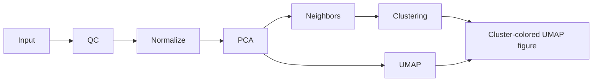

# Pipelines with custom steps

A workflow package defines its own tabs, parameters, R steps, and result panels.
It runs alongside the built-in analysis pages. The application owns the UI;
authors supply data contracts and R source, without adding React components.

## Install and run

1. Open **Pipelines → Import workflow** and select a `.pipeline.json` file.
2. Review the version and R source, then choose **Install**. Import and install
   do not upload data or execute code.
3. Select a saved analysis you own and open the installed workflow. Save pending
   changes to the selected analysis first.
4. Run the available steps. A lock explains a missing prerequisite on hover or
   keyboard focus. Clicking a locked tab does not run anything.
5. Use **Save workflow** to retain a named snapshot. **Back to Pipelines** leaves
   current work available; **Discard working results** removes that working copy
   while preserving saved snapshots.

Installed packages belong to the signed-in browser account. Export the exact
version to share it or move it to another browser. Different versions may coexist;
changing an installed ID/version's contents requires a new version number.
Removing a package from the browser does not delete its server-side work.
Reinstalling and opening the same version on the same saved analysis resumes it.

Execution requires the private [isolated R runtime](deployment.md#optional-expert-r-sandbox),
an account with `expert_r.execute`, and an owner, admin, or analyst project role.
Once access is configured, installations and individual runs need no operator
approval. Public demo deployments can import and export packages but do not run
custom code. The global catalog still contains built-in tool definitions;
workflow packages are currently shared as files.

## Dependencies and reruns

Dependencies come from input bindings, not tab order. The included example has
two branches after PCA:



A tab is available when at least one of its steps can run. If a tab also contains
a plotting step with different prerequisites, that panel explains its own lock.

Editing parameters changes a draft. It does not clear existing results. The
**Applied settings** disclosure records the settings that produced those results.

A successful run validates all declared outputs before replacing working state
in one database transaction. Changed outputs clear the steps that consume them
and their descendants; unrelated branches remain. A plotting step is an ordinary
step, so changing only its appearance does not rerun upstream analysis.

Identical bytes, type, size, and runtime profile retain existing output references.
Opaque RDS output additionally requires the same source, parameters, seed, and
runtime image. This is conservative byte equality, not a scientific equivalence
test: Seurat metadata can change serialized bytes even when a visible plot looks
the same. When equality cannot be established, dependent work is cleared.

Failures and cancellation keep the previous results. While a replacement is
running, dependent tabs are temporarily locked. Only one step runs in a working
workflow at a time. Repeated submissions with the same request ID create one job;
late or canceled jobs cannot overwrite newer state.

Snapshots pin the package, root analysis, applied settings, input references,
runtime receipts, and current outputs. Opening one restores that state and the
form settings together. Snapshots appear for the selected starting analysis and
remain private to their owner. They do not become built-in Seurat checkpoints or
automatically grant collaborators access to custom R objects.

## Author a package

Keep `pipeline.json` beside the R sources. The packer embeds only the declared
entry files and validates the complete package before writing it:

```sh
npm run workflow:pack -- examples/pipelines/scrna-workflow scrna-workflow.pipeline.json
```

The output path must not already exist. Import it through **Import workflow**.
The [single-cell example](../examples/pipelines/scrna-workflow/pipeline.json)
contains QC, normalization, PCA, neighbors, clustering, UMAP, and a separate R
plotting step within the UMAP tab.

A minimal author manifest looks like this:

```json
{
  "format": "traceomics-workflow",
  "schemaVersion": 1,
  "id": "cell-summary",
  "name": "Cell summary",
  "version": "1.0.0",
  "description": "Count cells in a saved analysis.",
  "runtime": { "language": "r", "profileId": "scrna-r-4.5-bioconductor-3.22-v1" },
  "steps": [{
    "id": "summary",
    "label": "Summary",
    "entry": "summary.R",
    "inputs": { "analysis": { "from": "input.analysis", "type": "rds" } },
    "parameters": [],
    "outputs": { "counts": { "type": "metrics", "label": "Cell count" } }
  }],
  "tabs": [{ "id": "summary", "label": "Summary", "step": "summary", "plots": [] }]
}
```

`summary.R`:

```r
write_output("counts", list(cells = ncol(inputs$analysis)))
```

Each step receives `inputs`, `params`, and `seed`. Bindings such as
`pca.analysis` identify a producing step and output port. `input.analysis` is the
immutable starting checkpoint. Scripts should use their declared inputs; the
underlying runner also exposes that same starting checkpoint as `obj`. It never
changes within an instance. Custom intermediate RDS files are deserialized only
inside the sandbox.

Call `write_output(port, value)` for every declared output. For a ggplot object,
use `write_output("figure", plot, width = 7, height = 5)`. Base R plots can instead
write the declared `<port>.png` under `/work/output` using `png()` and `dev.off()`.
Undeclared files cause the run to fail. Each step has one R entry file; helper
files, install scripts, network requests, and extra package dependencies are not
part of this format. Use packages present in the installed runtime profile.

The runner sets the random seed before evaluating source. Algorithms with their
own seed parameter must also receive `seed`, as the example's Seurat calls do.

### Templates

| Parameters | Fields |
| --- | --- |
| `integer`, `number` | `key`, `label`, `default`, optional `min` and `max` |
| `boolean` | `key`, `label`, boolean `default` |
| `choice` | `key`, `label`, `default`, bounded string `options` |
| `text` | `key`, `label`, `default`, optional `maxLength` (up to 2,000) |

| Outputs | R value / display |
| --- | --- |
| `metrics` | Named list of up to 40 scalar values |
| `table` | Data frame serialized as rows; up to 50,000 rows and 100 consistent scalar columns; paginated viewer |
| `scatter` | List with numeric vectors `x`, `y`, distinct string `ids`, optional string `groups`; up to 100,000 points and 40 groups |
| `figure` | PNG, at most 8,192 pixels per side and 25 million pixels total |
| `rds` | Opaque R object for dependent sandbox steps and download |

Each JSON output is limited to 5 MiB. Tables, metrics, scatter data, and RDS can
be step inputs. Figures are display outputs. IDs identify cells or rows; scripts
must align joined data by these IDs, not assume matching row order. The example's
cluster-colored plot checks alignment before plotting.

Every execution step appears exactly once as a tab's primary `step` or in its
`plots` array. All use the same Run and dependency rules. Feature selectors,
multiple-choice fields, custom browser widgets, and arbitrary HTML/SVG views
are not supported in this version.

## Storage and trust

The server revalidates packages and parameters, checks ownership and execution
access at admission and completion, and controls input mounts and output paths.
The broker runs R as a non-root user in a fresh container with no network,
read-only inputs, and CPU, memory, process, runtime, and disk limits. Choosing a
trusted author does not grant access to other projects, host files, or secrets.
The server verifies output hashes, sizes, JSON shapes, and PNG headers/dimensions
before making them available. PNG validation is not a full image decoder.

Current limits:

- 512 KiB per package, 64 KiB of metadata, 40 steps, and 30 KiB per R source.
  The compiled script, including parameters and the wrapper, must fit 32 KiB.
- Five inputs, eight outputs, and 24 parameters per step; 200 MiB total outputs
  per run. Up to three queued/running jobs per account.
- Twenty installed versions per browser account, 20 working workflows and
  40 saved snapshots per server account.
- 1 GiB of retained workflow outputs per account. Admission reserves another
  200 MiB for each in-flight run before replacing current files.
- Working instances expire after seven days without access. Cleanup is attempted
  hourly when the workflow API is used, and after replacements and deletions.
  Referenced snapshot files remain; old unreferenced files are removed.

These bounds target small private workflows; they are not large-dataset capacity
guarantees. Saves retain references rather than duplicate file bytes. Backups
must include both PostgreSQL and the storage tree. Package source remains in
installed working/saved workflow definitions so they can be reproduced; terminal
jobs still erase their redundant inline script according to the Expert R policy.

## Implementation and checks

`shared/workflowPackage.mjs` validates the package; `shared/workflowState.mjs`
defines dependency and replacement rules. `backend/workflowRuntime.js` owns
admission, persistence, snapshots, and collection. `backend/workflowWorker.js`
joins the existing queue to the broker, then commits accepted results and job
completion together. The browser library and workbench render the same contract.

Frontend tests cover parsing, branching, draft settings, accessible locks, and
stale responses. PostgreSQL tests cover atomic replacement, cancellation,
permission revocation, idempotency, saved references, and expiry. Run
`npm run test:expert-r-sandbox` for real R containment checks and
`npm run test:expert-r-browser` for the complete example, figures, reruns, and
snapshot restoration. Both integration checks require Docker; the browser check
also needs a test PostgreSQL connection.
